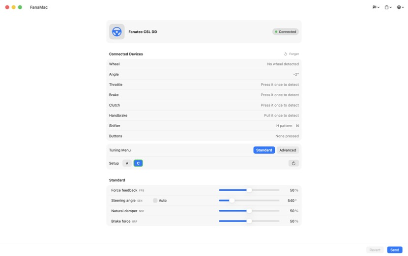

<h1 align="center">FanaMac</h1>

<p align="center">
  <b>Your Fanatec wheel on the Mac, with force feedback.</b><br>
  Tune the wheelbase and feel the road in your games. No driver to install.
</p>

<p align="center">
  <a href="https://github.com/kxlion/fanamac/releases/latest"></a>
  
  <a href="LICENSE"></a>
</p>

<p align="center">
  <a href="https://github.com/kxlion/fanamac/releases/latest"><b>Download for Mac</b></a>
  &nbsp;·&nbsp; <a href="#install">Install</a>
  &nbsp;·&nbsp; <a href="#play-with-force-feedback">Play</a>
  &nbsp;·&nbsp; <a href="#other-fanatec-bases">Other bases</a>
  &nbsp;·&nbsp; <a href="#if-it-doesnt-work">Help</a>
</p>



Fanatec's own app only exists for Windows. FanaMac is a native Mac app that does the essentials: it changes the wheelbase's settings and gives Windows games running through CrossOver their force feedback.

It's an early version. The CSL DD is the only base tested so far, and the goal is to cover every Fanatec base. Nine other bases are recognised and wait for an owner to confirm them: see [Other Fanatec bases](#other-fanatec-bases).

FanaMac is an independent project, not affiliated with or endorsed by Fanatec.

> [!WARNING]
> A direct drive base is strong enough to injure. On the CSL DD, FanaMac doesn't limit the force; on an untested base it caps it at 25 %. It cuts it only on a normal quit, on a USB write error, and when force packets stop for 0.25 s. A hung game or a FanaMac crash can leave a force on. Keep the base's power within reach, and use this at your own risk.

## What you get

- **Force feedback in games.** Windows games running through CrossOver, unchanged. Native Mac games are untested.
- **The whole Tuning Menu.** Setups 1 to 5 read and written from the Mac, in Standard or Advanced mode.
- **Game presets.** Fanatec's recommended settings per game.
- **Export and import.** One setup per JSON file, to back up or share.
- **Live inputs.** Wheel angle, pedals, handbrake, shifter, buttons and rim, as they move.
- **Calibration.** Wheel centre and H-pattern shifter.
- **Mouse emulation.** The rim's joystick moves the cursor, so you can stay in the seat.

Nothing is installed in the system or in CrossOver, and games are not modified.

## Tested with

| Item | Tested on |
|---|---|
| Base | CSL DD, PC mode (red LED) |
| Rim | ClubSport Steering Wheel RS |
| Shifter | ClubSport Shifter SQ V1.5 |
| System | macOS 26 on Apple silicon |
| Games, through CrossOver | Assetto Corsa Competizione, DiRT Rally 2.0 |

Other rims and games may work and haven't been tried. Mouse emulation's joystick and button are only known for the RS rim.

## Other Fanatec bases

FanaMac recognises these bases from what the Linux driver [hid-fanatecff](https://github.com/gotzl/hid-fanatecff) and Fanatec's Windows driver say about them. None of them has been run with FanaMac yet.

| Base | Status |
|---|---|
| CSL DD | Tested |
| Podium DD1, Podium DD2 | Untested |
| CSL Elite, CSL Elite PS4 | Untested |
| ClubSport V1, ClubSport V2, ClubSport V2.5 | Untested, no Tuning Menu over USB |
| CSR Elite, Porsche 911 | Untested, no Tuning Menu over USB |
| ClubSport DD, ClubSport DD+, GT DD Pro, Podium DD | Unknown: may be detected as a CSL DD, see below |
| Any other | Not detected yet |

> [!WARNING]
> Fanatec's own software gives the ClubSport DD, ClubSport DD+, GT DD Pro and Podium DD the same USB identity as the CSL DD. If FanaMac shows one of them as a CSL DD, it doesn't cap the force. Set the game's force feedback very low first, and please send a diagnostic.

The base must be in PC mode: FanaMac doesn't talk to a base in PlayStation mode.

On an untested base, FanaMac shows the inputs and reads the active setup, and writes nothing. To go further, choose Wheelbase > Experimental Mode: FanaMac then writes settings and passes the games' forces, capped at 25 %. Keep your hands clear of the wheel the first time.

**If you own one of these bases, you can get it supported.** Nobody else has to own it:

1. Turn the base on in PC mode and open FanaMac.
2. Choose Help > Save Diagnostic.
3. During the 10 seconds, turn the wheel lock to lock, press each pedal fully and press a few buttons.
4. Attach the file to [an issue](https://github.com/kxlion/fanamac/issues), with the name of your base, rim and pedals.

The file holds what the base says about itself over USB: its identity, its HID descriptor, its active setup and which bytes moved. It holds no serial number. This also works for a base FanaMac doesn't detect. Details in [docs/BASES.md](docs/BASES.md).

## Install

You need:

- an Apple silicon Mac on macOS 14 or later
- a CSL DD connected by USB, or [another Fanatec base](#other-fanatec-bases) if you accept that it is untested
- [CrossOver](https://www.codeweavers.com/crossover), the app that runs Windows games on a Mac, with your game installed in it

Then:

1. Download `FanaMac-x.y.dmg` from the [latest release](https://github.com/kxlion/fanamac/releases/latest).
2. Open it and drag FanaMac onto the Applications folder.
3. Open FanaMac from Applications. macOS refuses the first time, because FanaMac isn't signed with a paid Apple developer certificate: click **Done**.
4. Go to System Settings > Privacy & Security, scroll down to the message about FanaMac and click **Open Anyway**. This is only needed once per version.

## Play with force feedback

Open FanaMac **before** CrossOver, every time. If CrossOver starts first, the game gets no force feedback, brake or handbrake.

1. Quit your game, Steam and CrossOver completely.
2. Turn the base on in PC mode (red LED).
3. Open FanaMac. At the top right, it must show **Connected** with a green dot.
4. Start CrossOver, then your game.
5. In the game's settings, assign the wheel and pedals and turn force feedback on.
6. Set the game's force feedback low for the first run, then raise it.
7. Leave FanaMac open while you play. A **Game** badge appears next to **Connected** when the game sends forces.

If you'd rather not think about the order, add FanaMac under System Settings > General > Login Items: it then opens with your session, before CrossOver.

Controls you set up before using FanaMac may no longer match: set them up again. In Assetto Corsa Competizione, the default Fanatec controls work and only the clutch has to be added by hand.

To change the base's settings, pick a setup in FanaMac, adjust it and click **Send**.

### If it doesn't work

| What you see | What to do |
|---|---|
| Orange dot, no force, or no brake and handbrake in the game | CrossOver was already running. Quit it completely, wait for the dot to turn green, then start it again |
| The dot stays orange after quitting | Part of CrossOver is still running, often `steamwebhelper`. Quit it in Activity Monitor |
| **Not connected** | Check the USB cable, and that the base is on in PC mode. With a base other than the CSL DD, see [Other Fanatec bases](#other-fanatec-bases) |
| **Untested base: read-only** under the base's name | Expected on a base other than the CSL DD. Wheelbase > Experimental Mode turns writes and force feedback on |
| Green dot but no force | Check that force feedback is on in the game and that the wheel is assigned there |

Something else? [Open an issue](https://github.com/kxlion/fanamac/issues) with your base, rim, game and what you see.

## Update

Quit FanaMac, your game, Steam and CrossOver. Download the new `.dmg` from the [latest release](https://github.com/kxlion/fanamac/releases/latest), drag FanaMac onto Applications and choose **Replace**. Then open it as in steps 3 and 4 of [Install](#install).

Your setups are kept. Mouse Emulation has to be allowed again after each update: see below.

## Mouse emulation

macOS asks for the Accessibility permission the first time. Allow FanaMac in System Settings > Privacy & Security > Accessibility, then turn Mouse Emulation on again. The rim's joystick moves the cursor and button 26 clicks.

It stays active during games so you can use their menus. Turn it off before driving.

After each update, macOS no longer recognises FanaMac. Run this in Terminal, then allow FanaMac again as above:

```bash
tccutil reset Accessibility app.fanamac.FanaMac
```

## Compared with the Fanatec App

| Function | Fanatec App | FanaMac |
|---|---|---|
| Tuning Menu, 5 setups | ✅ | ✅ |
| Standard / Advanced menu | ✅ | ✅ |
| Recommended settings per game | ✅ | ✅ |
| Profile export and import | ✅ | ✅ |
| Force feedback in games | ✅ | ✅ |
| Centre calibration | ✅ | ✅ |
| Shifter calibration | ✅ | ✅ |
| Reset of all setups | ✅ | ✅ |
| Mouse emulation | ✅ | ✅ |
| Profile per game and car, applied when the game starts | ✅ | ❌ |
| Motor sensor calibration | ✅ | ❌ |
| Pedal and handbrake calibration, curves | ✅ | ❌ |
| FullForce effects | ✅ | ❌ |
| Game telemetry | ✅ | ❌ |
| Rev lights and button colours | ✅ | ❌ |
| Wheel display (gear, speed, pages) | ✅ | ❌ |
| Rim vibration motors | ✅ | ❌ |
| Firmware updates | ✅ | ❌ |
| Online services | ✅ | ❌ |

In FanaMac, Auto Setup is shown but can't be edited, and switching between Standard and Advanced asks for confirmation first.

## How force feedback works

| Step | Component |
|---|---|
| 1 | The game, unchanged, through Wine DirectInput and SDL2 under CrossOver |
| 2 | `ForceFeedback.framework`, which loads FanaMac's plug-in |
| 3 | `FanaMacFF.plugin` computes the effects and sends them over UDP on `127.0.0.1:9310` |
| 4 | FanaMac turns them into USB frames for the base |

## For developers

To build from source, install Apple's developer tools with `xcode-select --install`, then:

```bash
git clone https://github.com/kxlion/fanamac.git && cd fanamac && app/build.sh
```

| Command | Result |
|---|---|
| `app/build.sh` | Builds `app/build/FanaMac.app`, force feedback plug-in included |
| `./release.sh` | Builds the app, then the release disk image `build/FanaMac-<version>.dmg` |
| `app/build.sh test` | Runs the app's tests, no hardware needed |
| `ffplugin/build.sh test` | Runs the force calculation tests |
| `app/build.sh cli` | Builds the development tool, `app/build/fanamac` |
| `app/build/fanamac diagnose` | Captures every Fanatec device into a diagnostic file |
| `app/build/fanamac ingest <file>` | Reads a diagnostic someone sent and says what matches |

The version number is the one line of the `VERSION` file: the app, the plug-in and the development tool all take it from there.

Builds use the macOS 26 SDK from the Xcode Command Line Tools. `app/build.sh` refuses to run while FanaMac is open.

| Path | Content |
|---|---|
| `app/Sources/FanaMacCore` | Protocol frames and state, no hardware access |
| `app/Sources/FanaMac` | USB access and the SwiftUI interface |
| `app/Sources/FanaMacCLI` | Development tool |
| `app/Tests` | Tests that need no hardware |
| `app/Tests/Fixtures` | Diagnostics sent by owners, replayed by the tests |
| `app/Presets` | Game presets |
| [`docs/BASES.md`](docs/BASES.md) | Base profiles, diagnostics and how a base becomes tested |
| [`docs/DEVICES.md`](docs/DEVICES.md) | Every Fanatec USB product ID known, and what FanaMac does with it |
| [`docs/PROTOCOL.md`](docs/PROTOCOL.md) | Every USB command seen so far |
| [`docs/PRESETS.md`](docs/PRESETS.md) | Format of the game presets |
| `ffplugin/` | Force feedback plug-in, in C |

## Licence

MIT, see [`LICENSE`](LICENSE). `app/Presets/fanatec_recommended.json` contains values and notes from Fanatec and is not covered by the MIT licence.

Fanatec and CSL DD are trademarks of their owner.
